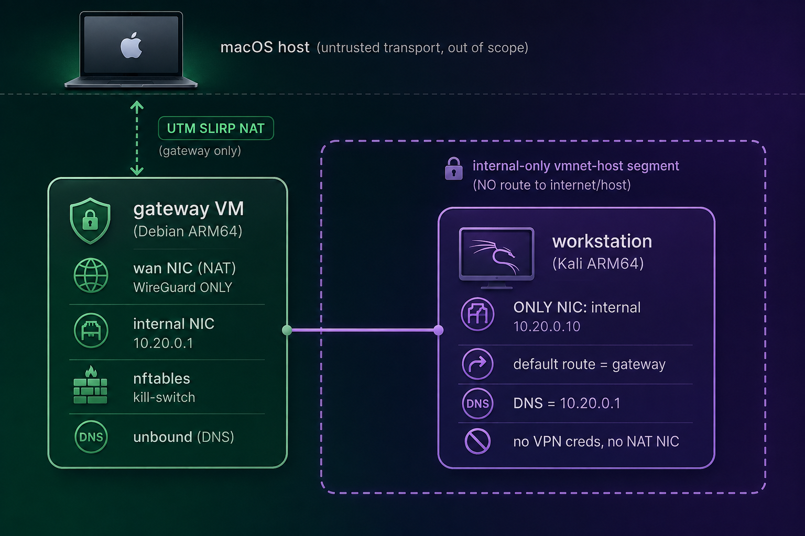

# UTM anonymous egress

A gateway VM plus an isolated Kali workstation on UTM for Apple Silicon.
The gateway is a single anonymity layer: a Mullvad multihop WireGuard tunnel
behind a fail-closed nftables kill-switch, with DNS resolved only through that
tunnel. The workstation has no independent path to the internet at all. The
macOS host is treated as untrusted transport and is out of scope by design.

`make verify` proves the property against the running lab, including an active
test that drops the tunnel and watches the WAN NIC.

> Read [Threat model](#threat-model) before relying on
> this. `make verify` asserts a negative: it proves the vectors someone
> thought of are closed, not that you are anonymous. The things most likely to
> undo the exercise (how you paid, where your account number has been, what
> the Mac is running) sit outside anything this code can check.

## Why a gateway and not just a VPN client

Against malware or tooling on the workstation, and against your own operating
mistakes, this is clearly better: the kill-switch is not on the machine that
runs your tools, so root there buys no route out and no credentials. The
absence of a path is structural rather than enforced by a daemon that can
crash, update or be clicked off, DNS cannot escape the tunnel, and `make verify`
lets you test all of it.

Against the network, against Mullvad, and against browser fingerprinting it
changes nothing. It is slightly worse on a hostile network: a plain WireGuard
config gets no DAITA, no post-quantum key exchange and no obfuscation, because
those are negotiated by Mullvad's own app. Check their current feature set if
that matters to you.

The gain that shows up most in practice is disposability. `make destroy` and
rebuild leaves no state and a fresh exit.

## Architecture

<div align="center">



</div>

The gateway is the only VM with a NAT NIC. The workstation's single NIC sits on
a host-only vmnet switch with no gateway of its own, so even a fully
compromised workstation has no route out except through the gateway. It has no
host port forward either: the host reaches it by SSH ProxyJump through the
gateway, including Ansible.

## Requirements

Apple Silicon Mac, Xcode Command Line Tools, and:

```bash
brew install --cask utm      # utmctl is called from inside the app bundle
brew install qemu ansible    # qemu-img; ansible
brew install xorriso         # optional: hdiutil is used if absent
```

Plus ~35 GB free (the Kali raw image alone is ~25 GiB) and a Mullvad
subscription. `make preflight` checks the tools and generates an SSH key.

> First run: macOS asks permission the first time your terminal controls
> UTM. Approve it (System Settings → Privacy & Security → Automation).

## Quick start

*Step 0* is the Mullvad subscription, and how you obtain it decides whether any
of the rest means anything. Pay with Monero or cash; a bank-linked
payment ties the account to your identity. The account number is the only
credential there is, and nothing in this build needs it. Keep it out of your
terminal, your shell history and anything that keeps a transcript.

Via a secure computer, a secure line and a secure browser, go to
https://mullvad.net/en/account/create and choose 'Generate account number.'
Save the account numer somewhere safe. Pay for your subscription, keeping
the above in mind.

Then in the left panel, go to WireGuard configuration. Generate a new key,
and select it. At the bottom select one or multiple exit locations, optional
content blocking and download the zip file. Put the files in the secret folder
and chmod them 600 as described below. Take it from there.

When you need to rotate keys or config, just follow the same steps, and run
a `make up` again. The playbook applies the new credentials to an
already-built gateway before anything needs the tunnel, so the run does not
wedge at the apt step. One caveat, by design: if the run *does* hang at apt
after a rotation, the new credentials themselves are the suspect (expired
account, revoked key); the gateway never falls back to clear-net to find
out. Confirm with `sudo wg show wg0 latest-handshakes` on the gateway:
anything other than `0` means the tunnel is up.

```bash
chmod 600 secrets/*.conf       # the bundle unpacks world-readable
cp lab.conf.example lab.conf
make preflight                 # checks tools; generates the SSH key and .env
$EDITOR .env                   # set MULLVAD_EXIT, e.g. "nl"
make up                        # images, VMs, cloud-init, Ansible
make verify                    # assert the property, read the output
make ssh workstation           # via ProxyJump through the gateway
```

`make preflight` refuses to build rather than guess: missing configs, a pair
that is not multihop, or an unusable config all stop it before any VM
exists. `make up` is idempotent. `make destroy` deletes both VMs and
`generated/` but keeps the base images; that is the disposable-workstation
mechanism.

A cold build is about 10 minutes with the desktop and no tool groups, excluding
the first-ever image download, which dominates everything. Half of it is the
workstation's ~950-package desktop coming over the VPN, so it tracks your exit
node more than your Mac.

Ansible prints a task name and then nothing until it finishes, so the longest
steps show no output. Silence is normal; silence *plus an idle VM* is a bug;
the build reconfigures the network underneath its own SSH connection, and a
rule that stops covering the management path drops the replies *and* the RST.
`ansible.cfg` sets `ServerAliveInterval` so that fails in ~2 minutes instead
of hanging. Watch with `make up 2>&1 | tee build.log` (not `| tail`, which
buffers) plus `make status` elsewhere.

## Commands

```bash
make up          # full hands-off build
make provision   # create and boot VMs only (no Ansible)
make configure   # run Ansible against running VMs
make status      # VM status via utmctl
make ssh <name>  # gateway (direct) or workstation (via the gateway)
make console <n> # serial console over UTM's pty (works on any kernel)
make verify      # the security property (see below)
make test        # shell unit tests, no UTM needed
make lint        # bash -n on scripts, ansible-lint if present
make down        # stop VMs
make destroy     # delete VMs and generated artifacts
```

## Configuration and secrets

Two gitignored files, each with a tracked `.example`: `lab.conf` holds
build configuration (fleet, image URLs, sizes, segment) and `.env` holds
console passwords and the entry and exit selection, at mode `0600`.

`make preflight` creates .env if missing, generating a distinct 24-character
password per VM and writing `.env` `0600` before any secret goes into it.
Nothing existing is overwritten.

### Host-only subnet

The internal segment rides an Apple vmnet host-only switch whose own subnet:
the `bridge100` address on the Mac. It is assigned by macOS, not this repo
(`192.168.128.0/24` by default), independent of `LAB_SEGMENT`.

### Collision with existing (TryHackMe) VPN

Very personal, but I needed to make some config changes because of it, so think
I should mention it.

The host-only subnet bites when that subnet overlaps a route the Mac already
has. A connected `/24` on `bridge100` outranks a VPN's pushed `/18`, so macOS
binds the VPN's routes to the bridge instead of the tunnel: the client says
"tunnel up" but hosts behind it are unreachable.

Moving the bridge is not cleanly possible on current macOS (`Host_Net_*` plist
keys are ignored for host mode; the `Shared_Net_Address` workaround reverts on
the next VM start), so this repo does not try. Instead `HOST_ONLY_SUBNET`
declares the subnet the bridge actually uses, and `make preflight` refuses to
build while a live route's gateway lands inside it. The remedy is operational:
bring the VPN or the VMs down before building. Preflight also warns if the
running bridge is on a different subnet, so a macOS default change surfaces
immediately. See [UTM](https://github.com/utmapp/UTM/discussions/4932) and
[Apple DTS 702377](https://developer.apple.com/forums/thread/702377).

## The anonymity layer

Three nftables chains, all `policy drop`. The only clear-net egress permitted
anywhere is UDP to one endpoint IP and port (the Mullvad entry server). Everything
else (the workstation's traffic, the gateway's own `apt`, unbound's upstream
queries) goes through the tunnel or nowhere.

Every config Mullvad's generator emits is single-hop. Drop them into
`secrets/` as `<hostname>.conf`, then name the exit country in `.env` as
`MULLVAD_EXIT` (`"bg"`, `"bg-sof"`, or an exact hostname). The build assembles
multihop by rewriting one line of the exit's own config:
`Endpoint = <entry ip>:<exit multihop port>`.

`MULLVAD_ENTRY` empty means any active server in a country other than the
exit's. Single-hop is refused, not discouraged: the build fails before any
VM exists if entry and exit are the same server, share a country, or resolve to
port 51820. The endpoint must be an IP, not a hostname; resolving a name
to bring the tunnel up would need clear-net DNS before the tunnel exists.

The config is sanitised before it reaches the gateway (the `DNS =` line
stripped, IPv6 removed, `PostUp`/`PreDown` hooks dropped) and installed on the
gateway only, mode `0600`.

Your choice is pinned in `generated/mullvad-exit.chosen` (hostnames, never
keys), so `make configure` cannot move your tunnel mid-lab. `make destroy`
clears it. `make verify` compares the exit `am.i.mullvad.net` reports against
the pin, *and* the pin against `MULLVAD_EXIT`. That second comparison is what
makes the first mean anything, since editing `.env` and verifying before
reconfiguring would otherwise match the old pin perfectly.

One fetch happens over your real IP: selecting a server needs Mullvad's
public relay list, fetched from the Mac before the lab exists, cached 7 days.
It reveals nothing Mullvad does not already see, the tunnel itself leaves
from this Mac, so their entry server has that address anyway.

When the tunnel is down, nothing moves. The gateway cannot `apt update` or
resolve a name; the workstation gets no ICMP, TCP or DNS. Management SSH keeps
working: it arrives on the port forward and cannot carry traffic outward.
`net.ipv4.ip_forward` is 0 on disk and switched on by `nftables.service` only
once the ruleset has loaded: a kernel forwarding with no rules is the one
combination that leaks everything.

DNS. `unbound` listens on `10.20.0.1` and loopback, never the WAN, and
forwards only to Mullvad's in-tunnel resolver. No fallback: a second, clear-net
forwarder *is* a DNS leak. The workstation's `:53` to any external resolver is
dropped in the forward chain, so a program hardcoding `8.8.8.8` fails rather
than bypassing unbound.

## What `make verify` proves

It detects the phase from the gateway itself, so there is no flag to forget:

| Check | What it means |
|-------|---------------|
| exit IP | asked from the workstation, Mullvad reports `mullvad_exit_ip: true`, on the country you chose |
| DNS | an uncached lookup resolves via `10.20.0.1`; UDP and TCP `:53` to external resolvers both fail |
| IPv6 | no v6 egress, with a positive control proving `ping -6` works at all |
| topology | the workstation still has exactly one NIC |
| no VPN client | no named client, and no `network-manager-*` plugin beyond the desktop's own |
| kill-switch | with `wg0` stopped: no ICMP, no TCP, no DNS, and no clear-net path for the gateway either |
| WAN silence | with `wg0` stopped, `tcpdump -Q out` on the WAN captures nothing but the permitted endpoint and management SSH |
| established flow | a flow already running through the tunnel cannot survive the tunnel dropping |
| boot ordering | `wg-quick` ordered after `nftables`, `nftables` enabled, forwarding not persistent |

The last three are why the suite is longer than it looks like it needs to be:

- conntrack does not key on the output interface. A flow established
  through the tunnel stays `ESTABLISHED` for days after the tunnel dies, so an
  unqualified `ct state established accept` re-admits it on the clear-net NIC.
  This repo shipped exactly that bug, and testing only *new* connections after
  tunnel-down passes cleanly while the hole is wide open.
- Asking the guest is not watching the wire. A leaked packet can leave
  un-SNATed, get no reply, and look "blocked" to a reply-based probe. Tested
  with a deliberately permissive forward rule, every guest-side check reported
  OK while packets were leaving. Only the capture caught it.
- Silence is never scored as security. A probe that failed to run, a cached
  DNS answer and a closed gateway all look identical, so every probe reports
  "did not run" distinctly from "was blocked", and anything ambiguous FAILS.

Satisfy yourself the suite can fail, by breaking it:

```bash
make ssh gateway
sudo nft insert rule inet filter forward iifname enp0s2 oifname enp0s1 accept
make verify                        # from the host: must FAIL, printing packets
make ssh gateway
sudo systemctl restart nftables    # restores the real ruleset
```

## Fleet layout

Each `LAB_VMS` entry is `"name:role [cpu=N] [ram=MiB] [disk=GB]"`. The role
decides the NIC layout:

| Role | NIC layout | Reached from the host by |
|------|-----------|--------------------------|
| `gateway` | `dual`: emulated NAT (internet + SSH forward) and internal NIC `10.20.0.1` | `ssh -p 2301 anon@127.0.0.1` |
| anything else | `internal`: only the internal NIC, default route the gateway | ProxyJump through the gateway |

The gateway must stay the first entry: its host SSH port is `2300 + index`,
and both the workstation's ProxyJump and `verify.sh` derive it from index 1.

## Consoles and the desktop

A `-cloud` kernel has no DRM drivers, so nothing binds to UTM's virtio-gpu and
the display stays dead. Hence the gateway uses Debian's `generic` image, and
the workstation (Kali ships only `genericcloud`) has Ansible swap in
`linux-image-arm64` and pin grub with `GRUB_DEFAULT=saved`. That needs apt,
which needs egress, which is why it waited for the tunnel: the kernel and every
package download through the VPN. If you remove the tunnel, set
`workstation_has_egress` to `false` first.

The desktop is `kali-desktop-xfce` plus Mullvad Browser, with a `lightdm`
greeter that never auto-logs in. One important gotcha: it hard-depends
on NetworkManager, which recommends ten VPN plugins. Those are purged and
asserted absent by `make verify`; NetworkManager itself is configured
`dns=none` with the NIC unmanaged, so it can neither take the interface nor
rewrite `/etc/resolv.conf`.

Serial console (`make console gateway`) works on any kernel and is the
recovery path when the display or network is what is broken. Detach with
`Ctrl-a k`, then `y`. cloud-init locks the account, so the console passwords in
`.env` are what make it more than a read-only view; that matters most for the
workstation, whose only other access is through the gateway. SSH stays
key-only on both. The role also removes Kali's agetty auto-login drop-ins,
which would otherwise hand anyone opening the console a root shell.

### Kali toolset

`KALI_TOOL_GROUPS="top10 web passwords"` in `lab.conf`, space separated,
without the `kali-tools-` prefix. Empty is a legitimate build.

The prefix is prepended by the code and never typed, which is a security
control: all 29 `kali-tools-*` groups pull no VPN package at all, while
`kali-linux-headless`, `-default` and `-large` each pull `openvpn` and `vpnc`
(and `-everything` adds `wireguard-tools`). Those four are exactly what the
no-VPN-client assertion would fail on, and none can be named here.

That measurement is not trusted on its own, since Kali can add a `Recommends`
at any time: the role re-checks after every install, purging anything
watch-listed and failing the build rather than running a purge that would take
the requested tools with it. Everything downloads through the tunnel, which is
why it can be slow (2 to 650 packages per group).

## Threat model

Target level: provider-resistant and leak-proof, with the correlation
resistance multihop buys and no more.

Guaranteed and testable: no clear-traffic leak (fail-closed kill-switch,
tunnel-only DNS, no IPv6), and entry and exit in different countries, so
neither Mullvad server sees both who you are and where you went.

Not covered by any check here:

- Your Mullvad account number is your only credential and cannot be
  rotated. Recovering from disclosure means buying a new account. Treat it as
  a bearer token, and keep it out of your shell history, your scrollback and
  any tool that keeps a transcript.
- Deleting a key file does not revoke the key, you have to remove it at Mullvad
  too.
- How you paid. A bank-linked payment ties the account to you and no tunnel
  repairs that.
- The macOS host. Untrusted transport, out of scope: a backup agent, EDR,
  MDM or screen recorder sees everything before it reaches the tunnel.
- One relay-list fetch over your real IP, though Mullvad sees that address
  from the tunnel regardless.
- Application-layer fingerprinting. A browser that identifies you does so
  just as well through a perfect tunnel. That is what Mullvad Browser is for.
- Timing and volume correlation by an adversary who sees both ends.
- What you do inside the session. Logging into an account that is yours
  ends the exercise however clean the plumbing is.

### Operator mistakes that break the guarantee

| You do this | What goes wrong |
|-------------|-----------------|
| Edit `MULLVAD_EXIT`, then `make verify` before `make configure` | You verify the old tunnel. The exit assertion catches it, but the order is `.env` → `configure` → `verify`. |
| Change `nftables.conf.j2` or `verify.sh` and skip the negative control | A too-permissive forward rule passes every guest-side probe. Only `tcpdump -Q out` catches it. |
| Leave Mullvad's config bundle at its unpacked mode | Hundreds of private keys world-readable. The build warns, but it scrolls past. `chmod 600 secrets/*.conf`. |
| `apt install` a VPN client on the workstation | The check knows named clients and `network-manager-*`. One under an unfamiliar name is not caught. |
| Trust "the tests pass" | Tests can pass without testing anything. Ask for the mutation evidence instead. |
| Reuse the workstation across engagements | It is disposable: `make destroy && make up` gives fresh Kali and a fresh pair. |
| Run the lab while a host VPN is up | The vmnet bridge can hijack a route inside its subnet. See "Host-only subnet". |

Residual technical failure: `nftables.service` failing to load at all means
no ruleset, and the kernel default is accept. That is why the ruleset is
installed with `nft -c` validation, so an unparseable file cannot land, and why
forwarding is granted by that unit rather than a persistent sysctl.

## Check the VPN connection

Of course there is the `make` tooling at the host, but you can do a few simple
tests in the VMs as well.

From the gateway.

```bash
make ssh gateway
systemctl is-active wg-quick@wg0 nftables unbound
sudo wg show
curl -s https://am.i.mullvad.net/json | jq
curl -s https://api.mullvad.net/app/v1/relays \
    | jq -r --arg ip "$(sudo wg show wg0 endpoints | cut -f2 | cut -d: -f1)" '
    .locations as $l
    | .wireguard.relays[]
    | select(.ipv4_addr_in == $ip)
    | "",
      "entry server:  \(.hostname)",
      "location:      \($l[.location].city), \($l[.location].country)",
      "hardware:      \(if .owned then "Mullvad owned" else "rented from \(.provider)" end)"'
```

From the workstation.

```bash
make ssh workstation
curl -s https://am.i.mullvad.net/json | jq
curl -s https://am.i.mullvad.net/json \
    | jq -r --arg dns "$(dig +short whoami.akamai.net)" '
    "",
    "exit server:   \(.mullvad_exit_ip_hostname // "UNKNOWN")",
    "location:      \(.city), \(.country)",
    "public ip:     \(.ip)",
    "dns egress:    \($dns)",
    "hosted by:     \(.organization)",
    "mullvad exit:  \(if .mullvad_exit_ip then "yes" else "NO - YOU ARE EXPOSED" end)",
    "blacklisted:   \(if .blacklisted.blacklisted then "YES" else "no" end)"'
```

## If you change this code

> A guard is not tested until someone has broken it and watched the test die.

"The suite is green" is nearly no information here. Every property in this repo
is a *negative* (no leak, no VPN client, not the wrong country) and a
negative passes by default. A test that never exercises its guard, a probe that
failed to run, and a closed gateway all produce the same silence.

So when you add or change a guard: delete it, run the covering test, and
confirm the test fails through the assertion that names that behaviour, not
through an unrelated crash. Then put it back and record what to break next to
the guard. Guards in this repo carry that note; several shipped looking correct
and were only caught this way, including one whose covering test detected its
own regression in just 14 of 30 runs because the selection it tested was random.

After any change to `nftables.conf.j2` or `scripts/verify.sh`, re-run the
negative control above: guest-side probes cannot see a packet that leaves
un-SNATed and gets no reply.

`make test` needs no UTM and no Mullvad account. `make lint` syntax-checks
every script. Both are cheap; run them constantly.

## License

GPLv3. See `LICENSE`.
